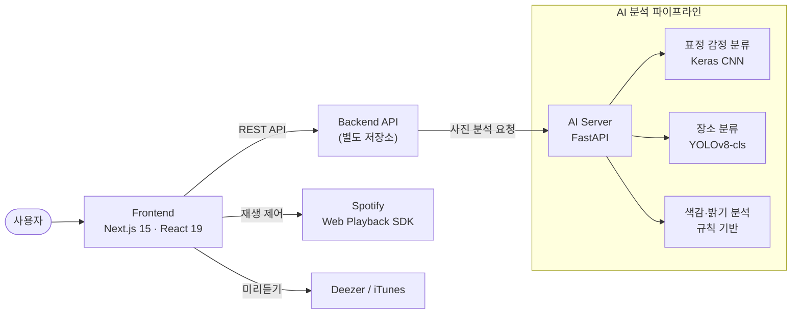

# MoodTune

> 사진 한 장의 분위기를 읽어, 그 순간에 어울리는 음악을 추천하는 웹 서비스

사진 속 **얼굴 표정**, **장소**, **색감과 밝기**를 AI로 분석해 사진의 분위기를 파악하고, 그에 맞는 음악을 추천합니다.
추천받은 곡은 Spotify로 바로 재생하고, 사진과 음악을 함께 포토 다이어리로 기록할 수 있습니다.

캡스톤 디자인 프로젝트 · 개발 기간 2025.07 ~ 2025.12

<br>

## 주요 기능

| 기능 | 설명 |
| --- | --- |
| 사진 분석 | 업로드한 사진에서 표정 감정, 장소, 시간대·색감 분위기를 추출 |
| 음악 추천 | 분석 결과를 바탕으로 사진 분위기에 어울리는 곡 추천 |
| Spotify 재생 | OAuth(Authorization Code + PKCE)로 계정을 연동하고, Web Playback SDK로 브라우저에서 바로 재생·일시정지·이전/다음 곡 |
| 미리듣기 | Deezer / iTunes 미리듣기 지원 (Next.js API Route로 프록시) |
| 사진 꾸미기 | 스티커를 붙이고 배치하는 캔버스 편집기 (Fabric.js, Konva) |
| 포토 다이어리 | 사진과 추천곡에 제목·내용을 붙여 일기로 저장 |
| 히스토리 · 랭킹 | 지난 분석 기록 다시 보기, 곡 순위와 순위 변동 표시 |
| 곡 추가 요청 | 추천 목록에 없는 곡을 검색해 추가 요청 |
| 온보딩 | 회원가입 후 선호 장르 선택 (K-POP, POP, Hip-hop, J-POP, 클래식, 트로트 등 9개) |

<br>

## 시스템 구조



> 이 저장소에는 **Frontend**와 **AI Server**가 들어 있습니다. 회원·사진·추천 데이터를 다루는 Backend API는 별도 저장소에서 관리됩니다.

<br>

## AI 분석 파이프라인

사진 한 장을 세 갈래로 분석한 뒤 하나의 결과로 합칩니다.

| 단계 | 방법 | 출력 예 |
| --- | --- | --- |
| **표정 감정** | OpenCV Haar Cascade로 얼굴 검출 → 가장 큰 얼굴을 224×224로 잘라 Keras CNN으로 분류 | `happy` (7종: angry, disgust, fear, happy, neutral, sad, surprise) |
| **장소 분류** | YOLOv8n 분류 모델을 직접 학습 | `cafe` (9종: beach, bedroom, cafe, classroom, gym, mountain, nature, park, street) |
| **색감·밝기** | 평균 밝기와 RGB 분포로 시간대·색조를 판정하고, 색조를 분위기 태그로 매핑 | `day`, `green/nature`, `calm/peaceful` |

**응답 예시** (`POST /analyze/`)

```json
{
  "emotion": "happy",
  "background": "cafe",
  "detail_tags": {
    "scene": ["cafe"],
    "rule": ["day", "yellow/bright", "happy/lively"]
  }
}
```

### 장소 분류 모델 학습 결과

| 항목 | 값 |
| --- | --- |
| 베이스 모델 | `yolov8n-cls` |
| 입력 크기 / 에폭 / 배치 | 224 / 20 / 16 |
| 검증 Top-1 정확도 | **93.9%** (최고, 16 에폭) · 93.7% (최종) |
| 검증 Top-5 정확도 | 99.8% |
| 클래스별 정확도 | 89% (cafe, park) ~ 100% (bedroom) |

<p align="center">
  
  
</p>

<br>

## 기술 스택

| 영역 | 사용 기술 |
| --- | --- |
| Frontend | Next.js 15 (App Router), React 19, TypeScript, Tailwind CSS, Radix UI, Fabric.js, Konva |
| AI Server | Python, FastAPI, TensorFlow / Keras, Ultralytics YOLOv8, OpenCV |
| 외부 연동 | Spotify Web API · Web Playback SDK, Deezer API, iTunes Search API |
| 배포 | Docker, Hugging Face Spaces (AI Server), Render (Backend) |

<br>

## 폴더 구조

```
capstone/
├── frontend/                  # Next.js 웹 클라이언트
│   └── src/
│       ├── app/               # 페이지 (recommend, editor, diary, onboarding, login …)
│       │   └── api/preview/   # Deezer · iTunes 미리듣기 프록시
│       ├── components/        # 플레이어, 히스토리, 업로드, 헤더, UI 컴포넌트
│       ├── contexts/          # 재생 상태, Spotify 연결 상태
│       ├── hooks/             # 데이터 조회 훅 (history, diaries, rankings …)
│       └── lib/               # API 클라이언트, Spotify SDK 래퍼
└── ai-server/                 # FastAPI 사진 분석 서버
    ├── app.py                 # API 엔드포인트, 분석 파이프라인
    ├── services/              # 감정 · 장소 · 규칙 기반 분석
    ├── models/                # 라벨 정보, 학습 결과 (가중치는 미포함)
    └── Dockerfile
```

<br>

## 실행 방법

### Frontend

```bash
cd frontend
npm install
npm run dev            # http://localhost:3000
```

`frontend/.env.local`에 다음 값을 설정합니다.

```bash
NEXT_PUBLIC_API_BASE=<Backend API 주소>
NEXT_PUBLIC_SPOTIFY_CLIENT_ID=<Spotify 앱 Client ID>
NEXT_PUBLIC_SPOTIFY_REDIRECT_URI=http://localhost:3000/spotify-callback
SPOTIFY_CLIENT_SECRET=<Spotify 앱 Client Secret>   # 토큰 갱신용, 서버에서만 사용
```

### AI Server

```bash
cd ai-server
pip install -r requirements.txt
uvicorn app:app --host 0.0.0.0 --port 7860
```

또는 Docker로 실행합니다.

```bash
cd ai-server
docker build -t moodtune-ai .
docker run -p 7860:7860 moodtune-ai
```

학습된 모델 가중치는 저장소에 포함되어 있지 않습니다. 다음 위치에 넣은 뒤 실행하세요.

- `ai-server/models/emotion/emotion_model.h5`
- `ai-server/models/yolo_scene_cls/train/weights/best.pt`

<br>

## 기여자

| 이름 | 담당 |
| --- | --- |
| [@Chasoonwook](https://github.com/Chasoonwook) | AI Server 전체, Frontend |
| [@Jinyoung0725](https://github.com/Jinyoung0725) | Frontend |
| [@MinJ01](https://github.com/MinJ01) | Backend (별도 저장소) |

<br>

## 저장소 이력

여러 저장소에 나뉘어 있던 코드를 커밋 기록을 유지한 채 하나로 합쳤습니다.

| 원본 저장소 | 위치 | 비고 |
| --- | --- | --- |
| `capstone_front` | `frontend/` | 최신 프론트엔드 |
| `capstone_full` | `frontend/` (기록) | 초기 통합본. 같은 기록에서 갈라진 사본이라 커밋 기록만 병합 |
| `capstone_AI` | `ai-server/` | AI 서버 초기 버전 (CNN + DeepFace + 규칙 기반) |
| `ai-photo-server` | `ai-server/` | AI 서버 정리 버전. `capstone_AI` 기록에 이어 붙임 |

AI 서버의 이전 버전 코드는 커밋 기록에서 확인할 수 있습니다. 학습된 모델 가중치 파일은 용량 문제로 이 저장소에서 제외했습니다.
